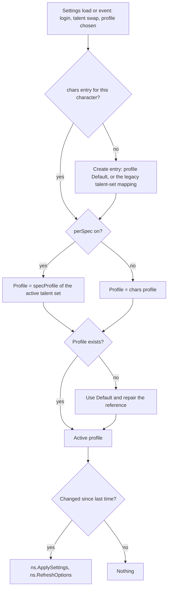
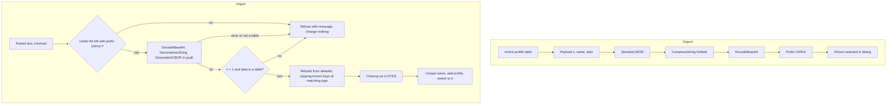

# Profiles with Import and Export - Plan

## Goal Capsule

- **Objective:** A player can keep several named setups of Overpower Alert, switch between them from the General tab, give each talent set its own setup, and recreate any setup on another character or account by pasting a text string, without losing the settings they have today.
- **Means:** Settings move into named, account-wide profiles that each character points at (KTD1), with a versioned, compressed text codec for export and import built on the game's own encoding functions (KTD6).
- **Authority:** The Product Contract's Requirements win on behavior. Key Technical Decisions win on mechanism within them. A unit overrides neither.
- **Stop conditions:** Stop and report if `C_EncodingUtil` turns out to be missing or different on the live Forever client (see Open Questions). Stop if the migration cannot keep an existing player's settings unchanged.
- **Execution profile:** One change set, committed by the user (the user commits by hand; no pull requests in this repo's workflow). Units are ordered by dependency.
- **Who finishes:** The implementer lands and verifies U1 to U6 in the emulator. The user does the in-game checks in the Verification Contract and commits.

---

## Product Contract

### Summary

Add a Profiles section at the top of the General tab: a dropdown of saved profiles with buttons to create, copy, rename, delete and reset them, plus Export and Import buttons that turn the active profile into a text string and back. The existing "separate settings for primary and secondary talents" option becomes a choice of which profile each talent set uses. Existing settings become a profile named "Default" on first load.

### Problem Frame

Overpower Alert has grown a lot of settings: four abilities, each with sounds, stances, text, icon, nameplate, glow and action bar options, plus the General tab's font and icon layout. A player has exactly one copy of all of it, shared by every character on the account, with a hidden second copy for secondary talents. They cannot keep a "tanking" and a "leveling" setup side by side, try a change without losing what worked, give an alt a different look, or hand a guildmate their setup. Rebuilding a setup by hand means re-dragging every icon and re-picking every sound.

### Requirements

**Profiles**

- R1. The General tab shows the active profile in a dropdown listing every saved profile, and choosing one applies all of its settings at once, including on-screen positions, sizes and the icon layout.
- R2. The player can create a new profile with default settings, copy the active profile into a new one, rename a profile, delete a profile, and reset the active profile to defaults.
- R3. Profiles are shared by every character on the account, and each character remembers which profile it uses. A character that has never chosen one uses "Default".
- R4. A profile named "Default" always exists. It cannot be deleted or renamed.
- R5. Deleting a profile that any character or talent set uses moves those users to "Default".

**Talent sets**

- R6. With "Use different profiles for primary and secondary talents" on, each talent set of the current character uses a profile the player picks, and swapping talents switches to that profile.

**Export and import**

- R7. Export gives the player a text string for the active profile, ready to copy, that holds every setting in it, including positions and the font.
- R8. Import takes a pasted string and adds it as a new profile, never overwriting an existing one, then makes it the active profile.
- R9. A string that is damaged, cut short, from another addon, or not a profile at all is refused with a message saying so, and nothing changes.

**Upgrade**

- R10. On the first load after updating, every existing setting is kept as the "Default" profile, so nothing visibly changes. A player who used separate talent-set settings keeps both setups, as two profiles assigned to their talent sets.

### Key Decisions

- **Talent sets choose profiles.** (session-settled: user-approved — chosen over keeping the hidden per-set copies beside named profiles: one model instead of two.) Governs R6, R10.
- **Profiles are account-wide, chosen per character.** (session-settled: user-approved — chosen over per-character profile lists: matches today's account-wide settings and lets an alt use a different profile.) Governs R3, R6.
- **Exports carry positions and the font, and imports add a new profile.** (session-settled: user-approved — chosen over exporting without positions and importing over the active profile: a shared setup looks the same on the other end, and the current profile stays intact.) Governs R7, R8.
- **Imports switch to the new profile.** The player sees the result straight away and can switch back. Governs R8.

### Success Criteria

- A profile exported on one character and imported on another, or on another account, reproduces the same sounds, text, icons, glows and positions.
- Updating the addon changes nothing a player can see or hear, including for players with separate talent-set settings turned on.

### Scope Boundaries

- Sending profiles to other players in game, over addon messages, is out. Players share strings through chat, Discord and the like.
- Exporting or importing a single ability's settings on its own is out.
- Slash commands for profiles are out. The General tab is the only entry point.
- Strings are not compatible with other addons' profile strings, in either direction.
- Considered and not built: an import preview before applying. Import already never overwrites (R8), so a bad import costs one delete. Reconsider if players report imports they regret.
- Considered and not built: undo for reset or delete. Both ask for confirmation (U5). Reconsider if players lose setups by accident.

#### Deferred to Follow-Up Work

- Removing the frozen legacy copy of the settings (KTD3) in a later version, once rollbacks to pre-profile versions are no longer a concern.

---

## Planning Contract

### Key Technical Decisions

- KTD1. **Profiles hold the settings, and characters point at profiles.** `OverpowerAlertDB.profiles[name]` holds one table per ability plus `general`. `OverpowerAlertDB.chars[charKey]` holds that character's chosen profile and talent-set choices. `ns.Config` and `ns.General` read through the active profile. This replaces the talent-set feature's copy-and-swap model (`SwitchToSpec` in `OverpowerAlert.lua`), which moves tables in and out of the top level and doesn't scale to more than two setups. With pointers, switching is a reference change, and no setting can be lost mid-copy.
- KTD2. **The character key is "Name - Realm", stored in the account-wide file.** It comes from `UnitName("player")` and `GetRealmName()` when settings load. A new `SavedVariablesPerCharacter` file was rejected: changing the TOC needs a full client restart (`docs/forever-client-research.md`, UI building blocks), and a second file means a second migration. If the name isn't available when settings load, use "Default" for that session's display and re-resolve on `PLAYER_LOGIN`.
- KTD3. **The upgrade runs once, from a `dbVersion` number, and leaves the old settings in place.** All copies below are deep copies.
  - **Old `perSpec` off:** the live top-level ability tables and `general` become `profiles["Default"]`, whatever `activeSpec` and `specProfiles` hold. Turning the old option off cleared neither, so a leftover stored set is stale and stays only in the frozen copy.
  - **Old `perSpec` on:** the live top-level tables belong to the set in `activeSpec`, and `specProfiles[<other set>]` holds the other set. Set 1's copy becomes "Default" and set 2's becomes "Secondary talents". With `activeSpec` 1, that means top-level to "Default" and `specProfiles[2]` to "Secondary talents". With `activeSpec` 2, it means `specProfiles[1]` to "Default" and top-level to "Secondary talents". When no other set is stored, only "Default" is made, from the top-level tables.
  - Both talent-set profiles get the live `general.font`. The old code shared the font between sets but left the stored set's own `font` stale, so this keeps the font the player sees today.
  - The old option was account-wide, so when it was on, `legacyPerSpec` records the mapping (primary "Default", secondary "Secondary talents"). Every character, on its first load after the upgrade, gets `perSpec` on with that mapping.
  - The old top-level tables stay untouched as a frozen copy, so rolling back to an older version still finds the settings. Removing them is deferred.
  - The per-profile cleanup that `LoadSettings` does today (defaults, value checks, the old `nameplateGap` and `anyStance` conversions) runs on every profile.
- KTD4. **Profile names are trimmed, 1 to 32 characters, and unique, compared without case.** "Default" is reserved (R4).
  - Rename rewrites every character's and talent set's reference, and the matching `legacyPerSpec` entries.
  - Delete is refused only for "Default". Every user of a deleted profile moves to "Default" (R5): characters, talent-set slots and `legacyPerSpec` entries. When that includes the current character, the switch is applied at once.
- KTD5. **Talent sets map to profile names, per character.** `chars[charKey]` holds `perSpec` and `specProfile[1]` and `specProfile[2]`. While `perSpec` is on, choosing in the profile dropdown sets the current set's profile. The existing talent-set detection (`ns.CheckSpec` and its events) stays and switches the active profile instead of swapping tables. The old "font is shared by both sets" rule goes away, since each profile now has its own font.
- KTD6. **Export strings are `!OPA1!` followed by Base64 of a Deflate-compressed CBOR payload, built with `C_EncodingUtil`.** (session-settled: user-approved — chosen over embedding serialization libraries: no new libraries, and other addons' strings are not compatible.) The payload is `{ v = 1, name = <profile name>, data = <profile table> }`. The prefix identifies the addon and the format version, so a later format can be told apart and other addons' strings fail fast. The emulator lists `SerializeCBOR`, `CompressString`, `EncodeBase64` and their reverses for Forever. Rejected: a hand-written serializer (more code to get right), and embedding LibSerialize and LibDeflate. Those are the fallback if the in-game check fails (Open Questions).
- KTD7. **An import is rebuilt from defaults, never trusted.** Decoding runs in `pcall`. Strings over 64 KB, without the prefix, or with an unknown version are refused before decoding.
  - The new profile starts from defaults: `Defaults()`, plus a `general` defaults table pulled out of `LoadSettings`'s inline checks.
  - Only known keys whose type matches the default's are copied in. `stances` is checked the same way, one level deep.
  - Positions have no default (`textPos` and `iconPos` are nil in `Defaults()`, and `general.groupPos` is set only by dragging), so they get their own rule. Each is copied only when it is a table whose [1] and [2] are anchor point names (TOPLEFT, TOP, TOPRIGHT, LEFT, CENTER, RIGHT, BOTTOMLEFT, BOTTOM, BOTTOMRIGHT) and whose [3] and [4] are numbers. Otherwise it is dropped, which puts it at the default spot. `ApplyPosition` passes these values straight to `SetPoint`, so a bad anchor name would otherwise raise an error.
  - Then the same cleanup as KTD3 runs. CBOR decodes to plain data, so nothing in a string can run.
- KTD8. **Dialogs are one small addon-owned frame, not `StaticPopup`.** It serves name entry (new, copy, rename, import), delete and reset confirmation, and a multi-line text box with a scroll bar for export and import. Export needs a multi-line box anyway, and an own frame keeps the addon away from Blizzard's shared popup.
- KTD9. **Switching profile reuses `ns.ApplySettings` (`Display.lua`) and `ns.RefreshOptions` (`Options.lua`).** The talent-set feature already uses both. `ns.ApplySettings` locks any unlocked frames, re-applies positions, sizes and layout, and refreshes any options page that's open.
- KTD10. **No new addon files.** Storage, migration, profile operations and the codec go in the saved-variables part of `OverpowerAlert.lua`, next to `LoadSettings`. The Profiles section and dialogs go in `Options.lua`, and strings in `Strings.lua`. The reason is the same restart requirement as KTD2. The new test files and fixtures in U1, U2 and U4 are not loaded by the TOC and are unaffected.

### High-Level Technical Design

Saved data after the upgrade (shape only):

```text
OverpowerAlertDB
  dbVersion = 2
  profiles
    "Default"           = { general = {...}, overpower = {...}, revenge = {...}, victoryrush = {...}, execute = {...} }
    "Secondary talents" = { ... }            -- only when the old talent-set option had a second set
  chars
    "Name - Realm" = { profile = "Default", perSpec = false, specProfile = { [1] = "Default", [2] = "Default" } }
  legacyPerSpec = { primary = "Default", secondary = "Secondary talents" }   -- applied to each character's first load
  overpower, revenge, ..., general, perSpec, activeSpec, specProfiles       -- frozen legacy copy, untouched (KTD3)
```

Which profile a character uses:



Export and import:



### Assumptions

- The live Forever client has `C_EncodingUtil` with the same functions the emulator lists. This is checked first (Open Questions).
- `UnitName("player")` and `GetRealmName()` return the character when `ADDON_LOADED` fires for this addon at login, as other addons' profile systems rely on. KTD2 covers the case where they don't.

### Risks

- **Downgrade after upgrading:** the old version would ignore `profiles`. The frozen legacy copy (KTD3) keeps the old settings readable, minus any changes made after upgrading.
- **Old settings carried into profiles:** the KTD3 cleanup already handles every known old shape. The legacy-profile tests in U1 cover the talent-set and pre-1.2 shapes.
- **Long strings in the edit box:** a multi-line `EditBox` needs no letter limit. Export strings should be a few KB, which the emulator check in U5 confirms.

---

## Implementation Units

### U1. Profile storage and upgrade

- **Goal:** Settings live in `profiles` and are read through the active profile, with existing saved settings upgraded once.
- **Requirements:** R3, R4, R10.
- **Dependencies:** none.
- **Files:**
  - `OverpowerAlert.lua`: `LoadSettings`, `ns.Config`, `ns.General`, `ns.GetFontPath`, `ns.AlertText`.
  - `tests/profiles.test.wowlua` (new).
  - `tests/profiles/warrior-legacy.json` and `tests/profiles/warrior-legacy-spec.json` (new world profiles with old-format saved variables).
  - Every test file that reads `OverpowerAlertDB.<ability>` or `OverpowerAlertDB.general`: `cooldown`, `execute`, `font`, `group`, `overpower`, `rage`, `spec`, `text`.
- **Approach:**
  1. Split `LoadSettings` into the per-profile cleanup (the existing per-ability and `general` normalization) and the database-level work: `dbVersion`, migration (KTD3), `chars`, and resolving the active profile (KTD1, KTD2).
  2. Point `ns.Config(key)` and `ns.General()` at the active profile. Change the direct `OverpowerAlertDB[...]` reads in `ns.AlertText` and `ns.GetFontPath` to use them.
  3. Update the tests to reach settings through `ns.Config` and `ns.General` instead of `OverpowerAlertDB` fields.
- **Patterns to follow:** the existing `LoadSettings` normalization and the pre-1.1 legacy move at the top of it.
- **Test scenarios:**
  - A fresh install has a "Default" profile with default settings, and the character uses it.
  - Old-format settings (a world profile seeding the old top-level tables, with Revenge's sound changed and an icon moved) come out as "Default" with that sound and position, and the old top-level tables are still present.
  - Old-format settings with the talent-set option on, the active set 2, and a second set stored come out as "Default" (set 1's settings, from `specProfiles[1]`) and "Secondary talents" (set 2's, from the top level). The character has `perSpec` on and the right mapping, and the active profile matches the active set.
  - The same with the active set 1 maps the top level to "Default" and `specProfiles[2]` to "Secondary talents".
  - With the talent-set option on, the stored set's font differing from the live font, both profiles come out with the live font.
  - Old-format settings with the talent-set option off but a leftover `activeSpec` 2 and `specProfiles[1]` come out as "Default" equal to the live top-level settings, with no "Secondary talents" profile and `perSpec` off.
  - A second character's first load after that upgrade also gets the talent-set mapping.
  - Loading twice doesn't migrate twice: `dbVersion` is set and the profiles aren't rebuilt.
  - A pre-1.1 database (Overpower settings at the top level) still upgrades into "Default".
  - A character whose saved profile name no longer exists falls back to "Default".
- **Verification:** All existing tests pass through the new accessors, and the upgrade scenarios pass. How a world profile seeds saved variables is checked against wowlua's world-profile docs while writing the fixtures.

### U2. Profile operations

- **Goal:** Create, copy, rename, delete, reset and switch profiles, with the result applied on screen.
- **Requirements:** R1, R2, R4, R5.
- **Dependencies:** U1.
- **Files:** `OverpowerAlert.lua`, `tests/profiles.test.wowlua`.
- **Approach:**
  1. Add `ns.` functions for each operation, applying the name rules and protections of KTD4. Each one returns success or a reason the UI can show.
  2. Switching sets the character's profile, or its current talent set's profile (KTD5), then runs `ns.ApplySettings` and `ns.RefreshOptions` (KTD9).
  3. Add a list function for the dropdown, sorted with "Default" first.
- **Patterns to follow:** `ns.SetPerSpec` and `ns.CheckSpec` for the apply-and-refresh sequence.
- **Test scenarios:**
  - Switching from "Default" to a profile with a 120 px Overpower icon and the grouped layout resizes and regroups the icons on screen.
  - New makes a profile with defaults. Copy makes one equal to the active profile, and changing the copy leaves the original alone.
  - Rename updates the character's and both talent sets' references, and a matching `legacyPerSpec` entry, and the switch still works afterward.
  - Renaming to an existing name in different case, an empty name, a name of only spaces, or a 33-character name is refused with a reason.
  - Renaming or deleting "Default" is refused.
  - Deleting the active profile switches the character to "Default" and applies it. Deleting a profile another character, or the `legacyPerSpec` mapping, uses moves that user to "Default".
  - Reset puts the active profile back to defaults and applies it.
  - Switching while icons are unlocked locks them first.
- **Verification:** The operation tests pass, and switching visibly reapplies settings in an emulator session.

### U3. Talent sets on profiles

- **Goal:** Each talent set uses a chosen profile, and swapping talents switches to it.
- **Requirements:** R6, R10.
- **Dependencies:** U2.
- **Files:**
  - `OverpowerAlert.lua`: replace `SwitchToSpec`, `PROFILE_KEYS` and the `specProfiles` swap. Keep `ns.ActiveSpecGroup`, `ns.CheckSpec` and their event registration.
  - `tests/spec.test.wowlua` (rewritten for the new model).
- **Approach:**
  1. `ns.SetPerSpec(on)` turns the character's `perSpec` on or off. Turning it on seeds both set slots with the current profile.
  2. Add a setter for each set's profile.
  3. `ns.CheckSpec` resolves the active profile through the flow in the High-Level Technical Design and announces a switch in chat, as it does today.
- **Patterns to follow:** the current `ns.CheckSpec`, which already checks on every likely swap event.
- **Test scenarios:**
  - With `perSpec` off, a talent swap changes nothing.
  - With it on, primary on "Default" and secondary on "Tank", swapping to set 2 makes "Tank" active and resizes the icons. Swapping back restores "Default".
  - Choosing a profile in the dropdown while on set 2 changes only set 2's profile.
  - Turning it on while on set 2 seeds both slots with the current profile, so nothing changes until the player picks a different one.
  - Deleting the profile set 2 uses moves set 2 to "Default".
  - `SPELLS_CHANGED` and `PLAYER_TALENT_UPDATE` also trigger the check.
- **Verification:** The rewritten spec tests pass. The upgrade scenario in U1 for talent-set users still passes.

### U4. Export and import codec

- **Goal:** Turn the active profile into a versioned string, and turn a string back into a safe new profile.
- **Requirements:** R7, R8, R9.
- **Dependencies:** U2.
- **Files:** `OverpowerAlert.lua`, `tests/profileio.test.wowlua` (new).
- **Approach:**
  1. Export builds the payload and encodes it as KTD6 describes.
  2. Import decodes and checks as KTD7 describes, then takes its name from the import dialog's name box. That box is pre-filled with the payload's name, and whatever the player leaves in it is used, with " (2)" and so on added when taken. It then adds the profile and switches to it through U2.
  3. Both return an error reason the dialog can show (R9).
- **Execution note:** Before building on it, ask the user to run a one-line in-game check that `C_EncodingUtil.SerializeCBOR`, `CompressString` and `EncodeBase64` exist and round-trip a small table. The result decides KTD6 against its fallback.
- **Test scenarios:**
  - Exporting a profile with a custom sound, a custom text, moved icons and a Shared Media font, then importing the string, gives an equal profile under a new name.
  - Importing a string whose name matches an existing profile adds "Name (2)" and leaves the original unchanged.
  - Empty text, text without the prefix, the prefix with garbage after it, a string cut in half, and a 70 KB string are each refused with a reason, and the profile list and active profile are unchanged.
  - A valid string with version 2 is refused as made by a newer version.
  - A payload with unknown keys, a string where a number belongs (`iconSize = "big"`), `stances` that isn't a table, and an out-of-range `iconSize = 999` imports as a profile with defaults for the bad values, `iconSize` clamped to 200, and the unknown keys dropped.
  - A payload with an `iconPos` of `{ "NOWHERE", "CENTER", 0, 0 }` and a `groupPos` of `"x"` imports with both positions dropped (default spots), and switching to it raises no error.
  - A payload missing whole abilities imports with defaults for those abilities.
- **Verification:** The codec tests pass in the emulator, and the in-game check above passed.

### U5. General tab Profiles section and dialogs

- **Goal:** The player manages, exports and imports profiles, and picks talent-set profiles, from the top of the General tab.
- **Requirements:** R1, R2, R6, R7, R8, R9.
- **Dependencies:** U2, U3, U4.
- **Files:**
  - `Options.lua`: `BuildGeneralPage`, the new dialog, and the General page height in `ns.CreateOptions`.
  - `Strings.lua`: new keys, and updated talent-set text replacing `PER_SPEC`, `PER_SPEC_HINT`, `EDITING_SPEC` and `EDITING_ALL`.
  - `tests/profiles.test.wowlua`: UI scenarios.
- **Approach:**
  1. A Profiles header with the dropdown, then New, Copy, Rename, Delete and Reset buttons, then Export and Import.
  2. Below that, the talent-set section: the current-set label, the checkbox, and, when it's on, a Primary profile dropdown and a Secondary profile dropdown. While it's on, the top dropdown's label names the current set, for example "Profile (Primary talents)", because choosing there sets that set's profile (KTD5).
  3. The font and icon-layout sections follow unchanged.
  4. The dialog (KTD8) has a title, an optional single-line name box, an optional scrolling multi-line text box, and OK and Cancel buttons. Escape closes it, and Enter confirms when there is no multi-line box.
     - Export opens it with the string selected and focused, ready to copy.
     - Import shows the text box and a name box, pre-filled with the payload's name once a valid string is pasted (U4).
     - Copy and Rename pre-fill the name box with the current name.
     - Delete and Reset confirmations name the profile and say that every character using it is affected.
  5. Delete and Rename are disabled for "Default".
  6. Error reasons from U2 and U4 show in the dialog in red.
- **Patterns to follow:**
  - `CreateRadioDropdown` and `CreateButton` in `Options.lua`.
  - The talent-set section and `ns.RefreshCurrentSet` as they are now.
  - The custom-sound box for a labeled `InputBoxTemplate`.
- **Test scenarios:**
  - Clicking New, typing "Leveling" and confirming adds "Leveling" to the dropdown and makes it active.
  - Choosing "Default" in the dropdown switches back, and the page's controls show Default's values.
  - Clicking Export opens the dialog with a non-empty string that starts with `!OPA1!`.
  - Pasting that string into Import and confirming adds a profile and switches to it.
  - Importing a garbage string shows the error in the dialog, which stays open, and the profile list doesn't change.
  - Delete is disabled while "Default" is selected.
  - With the talent-set checkbox on, both talent-set dropdowns show, and changing the Secondary one updates the character's set 2 profile.
- **Verification:**
  - The UI tests pass.
  - An emulator screenshot of the General tab shows the section laid out without overlap at the default window size.
  - The export dialog shows a long string and scrolls.

### U6. Documentation

- **Goal:** Players and future maintainers can find out how profiles work.
- **Requirements:** R1 to R10.
- **Dependencies:** U5.
- **Files:** `README.md`, `docs/forever-client-research.md`.
- **Approach:**
  1. In the README, replace the talent-set bullet in the General tab section with a Profiles bullet (operations, per-character choice, talent sets, export and import, the Default rules), and note the one-time upgrade.
  2. In the research doc, record the in-game result for `C_EncodingUtil`.
- **Test expectation:** none, documentation only.
- **Verification:** The README describes every control on the General tab, and the research doc has the `C_EncodingUtil` result.

---

## Verification Contract

| Check | Command or step | Applies to |
|---|---|---|
| Unit and UI tests | `wowlua test` (all files pass, including `tests/profiles.test.wowlua`, `tests/profileio.test.wowlua` and the rewritten `tests/spec.test.wowlua`) | U1 to U5 |
| Static check | `wowlua check` (no errors; pre-existing warnings allowed) | U1 to U5 |
| Emulator UI | wowlua MCP session: `/opa`, General tab screenshot, create, switch, export and import by hand | U5 |
| In-game: encoding | `C_EncodingUtil` exists and round-trips a small table (user runs a one-line `/run` command) | U4, before building on it |
| In-game: upgrade | Update over the user's real `OverpowerAlertDB`: nothing visibly changes, and the dropdown shows "Default" (plus "Secondary talents" if the talent-set option was on) | U1, U3 |
| In-game: sharing | Export on one character, import on another: same look and sounds | U4, U5 |

---

## Definition of Done

- R1 to R10 hold, each covered by a scenario in U1 to U5 or an in-game check above.
- `wowlua test` and `wowlua check` pass.
- The user's own saved settings upgrade with nothing visibly changed, confirmed in game.
- The `C_EncodingUtil` result is recorded in `docs/forever-client-research.md`.
- No dead code from the old copy-and-swap talent-set model (`SwitchToSpec`, `PROFILE_KEYS`, `specProfiles` handling outside the upgrade) remains outside the upgrade path. No abandoned experiment code remains.
- No change was committed by the agent; the user commits.

---

## Open Questions

- **Is `C_EncodingUtil` on the live Forever client, and does it round-trip?** This is blocking for U4 only, and the in-game check in U4's execution note answers it. If yes, KTD6 stands. If no, stop, as the Goal Capsule says. Ask the user whether to embed LibSerialize and LibDeflate under `Libs/` instead. That reverses the settled KTD6 and changes the TOC, which needs a client restart.

### Deferred to Implementation

- The exact `CompressString` method argument (`Enum.CompressionMethod` value) on this client.
- The exact helper names for profile operations and the dialog builder.
- The final General page height after the new section is laid out.
