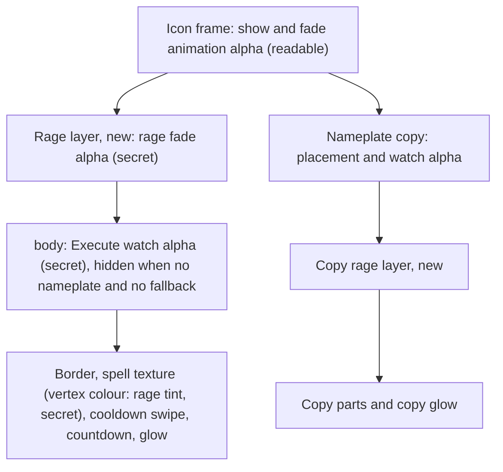

# Rage Threshold Icon Look - Plan

## Goal Capsule

- **Objective:** While an ability's alert icon is up, a warrior can see at a glance whether their rage has reached a level they chose for that ability, in any stance, without the addon ever reading their rage.
- **Means:** The game evaluates the hidden rage through a step curve and the result goes straight to the icon's colour or transparency (KTD1), the same technique the Execute icon already uses for hidden target health in Defensive Stance.
- **Authority:** The Product Contract's Requirements win on behavior. Key Technical Decisions win on mechanism within them. A unit overrides neither.
- **Stop conditions:** Stop and report if, in game, `UnitPowerPercent` for rage is missing, errors, or does not move the icon as rage crosses the threshold. Stop if the extra frame layer (KTD3) changes how existing icons look or behave.
- **Execution profile:** One change set, left uncommitted in the working tree. The user commits by hand; the agent does not commit, push, branch or open PRs. Units are ordered by dependency.
- **Who finishes:** The implementer lands U1 to U4 and verifies them in the emulator. The user does the in-game checks in the Verification Contract and commits.

---

## Product Contract

### Summary

Each ability tab gets a rage threshold, off by default. While that ability's icon is up and your rage is below the threshold, the icon either takes a colour you pick or fades to see-through, set per ability. At or above the threshold it looks normal. Sounds, on-screen text and when alerts fire do not change.

### Problem Frame

When an alert pops, the warrior's next question is often whether they have the rage to use it well. That matters most for Execute, which turns extra rage into damage, but it also matters for Overpower or Revenge when the player wants rage left over for something else. The only rage cue today is "Tint blue when short on rage". It answers a narrower question: whether the game would refuse the cast for lack of rage. It only works at the spell's own cost, and only in the stance the spell is cast in.

The game hides the player's rage from addons on this client (`docs/forever-client-research.md`, "Target health (Execute)" row). The Execute icon in Defensive Stance already shows that a hidden value can still drive what's drawn. The addon hands it to the icon through a curve without ever reading it. Other addons on the Forever client do the same with hidden energy and mana through `UnitPowerPercent` (EllesmereUI's nameplate class power and ready-check mana warning).

### Requirements

**Threshold and look**

- R1. Each ability has its own rage threshold, from 0 to 100 rage. 0 means off and is the default for every ability.
- R2. While the icon is up and rage is below the threshold, the icon shows the ability's chosen look. At or above the threshold it looks normal. The look follows rage as it changes while the icon stays up.
- R3. The look below the threshold is a per-ability choice. Tint colours the spell texture with a colour the player picks, defaulting to the same blue as "Tint blue when short on rage". Fade makes the whole icon see-through, including its glow, border, cooldown swipe and countdown.
- R4. It works in every stance the ability alerts in, including Execute's health-driven icon in Defensive Stance.
- R5. The nameplate copy of the icon ("Also show the icon at its normal position") gets the same look as the main icon.

**What it does not change**

- R6. The threshold never changes sounds, on-screen text, action bar glows, or when an alert starts or ends.
- R7. Previews (`/opa test`, the Preview button, choosing settings) and unlocked icons ignore the threshold and show the normal look.
- R8. With a threshold set and Tint chosen, the threshold's colour replaces the blue from "Tint blue when short on rage". With Fade chosen, or no threshold, that blue tint works as it does today.

**Settings**

- R9. The threshold, look and colour are saved in the active profile and carried by profile export and import. Out-of-range or malformed values, from old saves or imported strings, fall back to safe values.
- R10. On a client without the needed game functions, setting a threshold does nothing and raises no error.

### Key Decisions

- **Icon only.** The addon never learns the rage value, so it cannot time a sound or text to the moment rage crosses the threshold. Governs R6.
- **Two looks, chosen per ability: tint or fade.** Tint keeps the icon readable while signalling "not yet". Fade makes the icon appear only once rage is there. Governs R3.
- **The threshold colour wins over the blue tint.** One colour on the icon at a time avoids a flicker between two answers. Governs R8.
- **Previews show the normal look.** This matches how previews already ignore cooldowns and the short-on-rage tint. It also keeps a faded icon from previewing as nothing out of combat, when rage is 0. Governs R7.

### Success Criteria

- In game, with a threshold of 30 on Overpower and Tint, the icon is the chosen colour below 30 rage and turns normal as rage passes 30 while the icon stays up.
- In game, with Fade on Execute in Defensive Stance, the icon only appears once both the target is below 20% and rage is at or above the threshold.
- Players who never touch the setting see no change at all.

### Scope Boundaries

- No sound, text or alert-timing changes (R6).
- No multiple bands or gradients, such as yellow at 15 and green at 30. Only one threshold per ability.
- The addon does not show the rage number anywhere.
- In grouped icon layout, a faded icon keeps its place in the row. The addon can't know the icon is invisible, so the gap stays.
- Considered and not built: using rage directly when it happens to be readable, so it could also gate sounds. Rage was secret in every in-game check so far. Revisit if `/run print(issecretvalue(UnitPower("player", 1)))` ever prints `false` in combat.
- Considered and not built: disabling the threshold controls on a client without the functions. The only client this addon targets has them (EllesmereUI ships for it, TOC 16001, and uses them for energy and mana). The in-game check in the Verification Contract confirms they work with rage.

#### Deferred to Follow-Up Work

- Tinting or fading the on-screen text by the same threshold.
- Glowing action bar buttons by the same threshold.

---

## Planning Contract

### Key Technical Decisions

- KTD1. **The game reads rage through `UnitPowerPercent("player", Enum.PowerType.Rage, …, curve)`, and the addon only passes the result on.** Rage percent equals rage points for a warrior (maximum 100), so the threshold T becomes a step at T/100. Using percent also avoids reading the maximum, which may be secret too. The result is handed directly to a drawing call, never compared or stored. This mirrors `ns.ExecuteCurve`/`ns.ExecuteAlpha` in `OverpowerAlert.lua`.
- KTD2. **Tint uses a step colour curve (`C_CurveUtil.CreateColorCurve`, `Enum.LuaCurveType.Step`).** The curve runs from the chosen colour below T/100 to white at T/100 and above, applied with `texture:SetVertexColor(color:GetRGBA())`. Every point keeps alpha 1 and only RGB varies. EllesmereUI notes it deliberately never relies on curve alpha interpolation. Reference: EllesmereUI's raid frame aura threshold, which builds a step colour curve in the same shape.
- KTD3. **Fade uses a plain step curve (0 below, 1 at and above) on a new layer frame between the icon frame and `body`, with a matching layer in the nameplate copy.** A secret alpha can't be multiplied in Lua. Putting rage on its own frame lets the engine multiply it with the Execute watch alpha on `body` and with the fade animation on the outer frame. Everything visible, including the LibCustomGlow glow, must sit under the layer. The copy is currently a single frame carrying its parts, glow and watch alpha, so it needs an inner layer, or a split that achieves the same.
- KTD4. **The look is re-applied on the icon's existing `onUpdate`, throttled like the watch check (`WATCH_CHECK`, 0.05 s), and once when the icon shows.** There are no new power events. The icon already re-checks every frame for nameplates, and one curve evaluation per 0.05 s per shown icon is negligible.
- KTD5. **Curves are cached per ability and rebuilt when the threshold, look or colour changes.** The options page calls `ns.ApplyIconStyle`, which already re-applies icon settings. Applying an existing curve every tick avoids rebuilding one each tick.
- KTD6. **The look is cleared on hide, the same way the cooldown look is cleared in the icon's `OnHide` hook.** Vertex colour goes back to white and layer alpha to 1, so the next show, preview or unlock starts clean (R7).
- KTD7. **Every game call is guarded and degrades to the normal look (R10).** That includes a missing `UnitPowerPercent`, a missing `C_CurveUtil`, a failing `pcall`, or a nil result, following the `pcall` pattern in `ns.ExecuteCurve`.

### High-Level Technical Design

Frame layering for the main icon and the nameplate copy (KTD3). Each frame's alpha multiplies into everything below it.

The icon's look in each case (KTD2, KTD3, R7, R8):

| Situation | Spell texture colour | Rage layer alpha |
|---|---|---|
| Threshold 0 | Blue if short on rage and that option is on, else white | 1 |
| Threshold set, Tint | Rage colour curve (chosen colour below, white at or above) | 1 |
| Threshold set, Fade | Blue if short on rage and that option is on, else white | Rage step curve (0 below, 1 at or above) |
| Preview or unlocked | White | 1 |
| Functions missing or call fails | As if threshold 0 | 1 |

### Risks

- **`UnitPowerPercent` with rage on Forever is unverified.** The function exists on this client, because EllesmereUI calls it for energy and mana. It has not been tried with rage, and the meaning of its third argument ("unmodified") is undocumented here. The first in-game check settles both. The Goal Capsule's stop condition applies if it fails.
- **The extra layer shifts frame levels and the parent chain.** Glow, swipe and countdown levels are set relative to `body`, so they should follow. But test helpers find `body` or the icon's parts through `GetChildren()` (`tests/rage.test.wowlua`, `tests/execute.test.wowlua`, `tests/group.test.wowlua`), and they will need to look one level deeper.
- **The emulator may not evaluate curves or `UnitPowerPercent`.** The Execute tests stub `ns.ExecuteAlpha` rather than rely on it. Tests here stub at the same `ns` seam, so the real curve path is proven only in game.

---

## Implementation Units

### U1. Settings and normalization

**Goal:** Each ability's settings hold a rage threshold, a look and a colour, validated on load and import.

**Requirements:** R1, R3, R9

**Dependencies:** none

**Files:**
- `OverpowerAlert.lua` (ability defaults, `NormalizeAbility`, the shared default blue)
- `Display.lua` (`NO_RAGE_TINT` reads the shared blue)
- `tests/ragethreshold.test.wowlua` (new)

**Approach:**
- Add three per-ability defaults: a threshold of 0, the look "tint", and a colour table with the same RGB as `NO_RAGE_TINT`.
- Keep that blue as three plain numbers in one place in `OverpowerAlert.lua`, and have `Display.lua`'s `NO_RAGE_TINT` read it, so the two don't drift. `Defaults(ability)` builds a new colour table on each call, as it does for `stances`, so no two abilities or profiles share one table.
- In `NormalizeAbility`, clamp the threshold to a whole number from 0 to 100. Reset an unknown look to "tint". Reset a colour to the default when it isn't a table of three numbers, and clamp each component to 0 to 1.
- Export and import need no codec change. `CopyKnown` copies new default keys and one level of nested table, type-checked, then `NormalizeProfile` runs.

**Patterns to follow:** existing `Clamp` calls and the `customText` handling in `NormalizeAbility`. Tests use `ns.Config(...)`, not `OverpowerAlertDB`.

**Test scenarios:**
- A fresh profile has threshold 0, look "tint" and the default blue for every ability.
- A saved threshold of 150 loads as 100, -5 as 0, and 12.6 as 13.
- A saved look of "glow" loads as "tint".
- A colour of `{ r = "x" }` loads as the default, and `{ r = 2, g = 0.5, b = -1 }` loads as `{1, 0.5, 0}`.
- Export, then import, of a profile with threshold 30, Fade and a red colour keeps all three on the imported profile.
- An imported string carrying threshold 999 lands as 100.

**Verification:** the scenarios pass, and existing profile and import tests still pass.

### U2. Rage curves and the icon look

**Goal:** A shown icon takes the rage look from the game's curve and drops it on hide, for the main icon and its nameplate copy.

**Requirements:** R2, R3, R4, R5, R7, R8, R10

**Dependencies:** U1

**Files:**
- `OverpowerAlert.lua` (rage curve building and evaluation, beside the Execute curve)
- `Display.lua` (rage layer frames, look application, `onUpdate`/`onShow`/`OnHide` hooks, `SetShortOnRage`)
- `tests/ragethreshold.test.wowlua`
- `tests/rage.test.wowlua`, `tests/execute.test.wowlua`, `tests/group.test.wowlua` (helpers that locate `body` or the icon's parts)

**Approach:**
1. In `OverpowerAlert.lua`, add `ns`-level functions. One builds and caches each ability's curve per KTD2 and KTD5. One returns the secret colour or alpha for an ability, or nil when the threshold is 0 or the game functions fail (KTD7). These are the seam tests stub, like `ns.ExecuteAlpha`.
2. In `Display.lua`, insert the rage layer per KTD3 for `body` and the plate copy. Move the copy's glow under its layer.
3. Apply the look on show and on the throttled `onUpdate` per KTD4. Skip it for previews and unlocked icons (R7), using the same `real` test that `UpdateCooldownLook` uses.
4. In Tint mode with a threshold set, make the threshold colour own the vertex colour, so `SetShortOnRage` leaves it alone (R8). In Fade mode, `SetShortOnRage` works as today.
5. Clear the look in the `OnHide` hook per KTD6.
6. Have `ns.ApplyIconStyle` drop the cached curve, so a settings change takes effect while the icon is up.

**Patterns to follow:** `ApplyWatchAlpha`/`SetWatching` and the `WATCH_CHECK` throttle in `Display.lua`. `ns.ExecuteCurve`'s guarded build in `OverpowerAlert.lua`.

**Test scenarios:**
- Threshold 0 on Revenge: after a block the icon texture is white and the rage layer alpha is 1.
- Tint, threshold 30, stubbed colour = chosen red: after a block the texture's vertex colour is red. Changing the stub to white turns it white within 0.1 s while the icon stays up.
- Tint with "Tint blue when short on rage" also on, and the game saying short on rage: the texture shows the threshold colour, not blue.
- Fade, threshold 30, Execute ticked for Defensive Stance with the watch alpha stubbed to 1: the rage layer follows the stubbed rage alpha (0, then 1), and `body` keeps alpha 1.
- Fade with the Execute watch alpha 0 and rage alpha 1: `body` is 0 and the layer is 1, and neither overwrites the other.
- Fade with "Tint blue when short on rage" on and the game short on rage: the texture is blue and the layer follows the rage alpha.
- `/opa test revenge` with the stub returning "below" (red, alpha 0): the preview icon is white and fully shown.
- Unlocking the icon while it's faded below the threshold: it shows fully for moving.
- Nameplate copy shown ("Also show the icon at its normal position" on, plate stubbed): the copy's texture and layer match the main icon.
- After the icon hides and an alert shows it again with threshold 0, it is white with layer alpha 1.
- Changing the threshold from 30 to 0 in options while the icon is up returns it to normal.
- `UnitPowerPercent` faked to nil with threshold 30: an alert raises no Lua error and the icon looks normal.
- Every existing test in `tests/rage.test.wowlua`, `tests/execute.test.wowlua`, `tests/group.test.wowlua` and `tests/overpower.test.wowlua` (which holds the nameplate tests) still passes after the helper update.

**Execution note:** make the layer insertion first and run the full suite before adding any rage logic. That proves on its own that the new frame changes nothing (Goal Capsule stop condition).

**Verification:** the scenarios pass. In a wowlua session, `/opa test` for each ability looks the same as before.

### U3. Ability tab controls

**Goal:** Each ability tab has controls to set the threshold, pick the look and pick the colour.

**Requirements:** R1, R3, R9

**Dependencies:** U1, U2

**Files:**
- `Options.lua` (`BuildAbilityPage`, page height)
- `Strings.lua`
- `tests/ragethreshold.test.wowlua`

**Approach:**
- Place the controls under "Tint blue when short on rage" in the spell icon section, before the move hint.
- Add a "Rage threshold" slider with a number box from 0 to 100, using `CreateNumberSlider`.
- Add a "Below it" dropdown (Tint / Fade out) using `CreateRadioDropdown`.
- Add a colour swatch that opens `ColorPickerFrame:SetupColorPickerAndShow`. Cancel restores the old colour. Both store a new colour table rather than changing the saved one's fields. The swatch is shown only when Tint is chosen.
- Add a one-line hint: only the icon changes, no sound or text.
- Each change saves to `ns.Config(abilityKey)` and calls `ns.ApplyIconStyle`.
- Grow the ability page height to fit. Add strings to `Strings.lua` as `L.KEY`.

**Patterns to follow:**
- The glow dropdown and icon size slider in `BuildAbilityPage`.
- The `menus` list for dropdown refresh.
- Platynator's `CustomiseDialog/Components.lua` and NaowhForever's `Core/Options/Widgets.lua` (both installed under `_forever_`) for `SetupColorPickerAndShow` usage on this client.

**Test scenarios:**
- Moving the slider to 25 on the Execute tab saves `ns.Config("execute")` threshold 25.
- Typing 140 in the box saves 100.
- Choosing Fade out saves "fade" and hides the swatch. Choosing Tint shows it again.
- Picking a colour and confirming saves it. Cancelling the picker restores the previous colour.
- Switching profile refreshes the three controls to the new profile's values.

**Verification:** the scenarios pass. A wowlua screenshot of the Overpower tab shows the controls laid out under the blue-tint checkbox with nothing overlapping.

### U4. Documentation

**Goal:** Players and future maintainers know what the threshold does and why it is icon-only.

**Requirements:** R6, R7, R8

**Dependencies:** U2, U3

**Files:**
- `README.md` (ability options list, How it works)
- `docs/forever-client-research.md` (rage through `UnitPowerPercent`, after the in-game check)

**Approach:**
- In `README.md`, add a "Rage threshold" bullet after "Tint blue when short on rage". Cover the off default, Tint vs Fade, that it works in every stance, that sound and text are unchanged and why, that previews ignore it, the grouped-layout gap, and that it takes over from the blue tint in Tint mode.
- In `docs/forever-client-research.md`, add a row with the in-game result for `UnitPowerPercent` and rage, and the third argument used.

**Test expectation:** none -- documentation only.

**Verification:** the README describes every requirement a player can observe, and the research doc records the in-game result.

---

## Verification Contract

| Check | Command or step | Applies to |
|---|---|---|
| Unit and UI tests | `wowlua test`: all files pass, including the new `tests/ragethreshold.test.wowlua` and the updated `tests/rage.test.wowlua` and `tests/execute.test.wowlua` | U1 to U3 |
| Static check | `wowlua check`: no new errors | U1 to U3 |
| Emulator UI | wowlua MCP session: `/opa`, screenshot an ability tab, set threshold, look and colour, then `/opa test` | U2, U3 |
| In-game: rage curve | Threshold 30, Tint, on Overpower or Revenge: in combat, the icon changes colour as rage crosses 30 while it stays up | U2, before U4's research row |
| In-game: fade with Execute watch | Execute ticked for Defensive Stance, Fade, threshold 30: the icon appears only when the target is below 20% and rage is at least 30 | U2 |
| In-game: no change by default | With no threshold set, icons look exactly as before | U2 |

---

## Definition of Done

- R1 to R10 hold, each covered by a scenario in U1 to U3 or an in-game check above.
- `wowlua test` and `wowlua check` pass.
- The in-game rage-curve result, and the third argument used, are recorded in `docs/forever-client-research.md`.
- No abandoned experiment code or temporary probe command remains.
- Nothing was committed by the agent; the user commits.

---

## Open Questions

### Deferred to Implementation

- Which value of `UnitPowerPercent`'s third argument gives raw rage. Start with `false`, as EllesmereUI does for mana, and confirm in game.
- Whether the wowlua emulator implements `UnitPowerPercent` and colour curves. Tests stub the `ns` seam either way.
- Exact helper names, and the final ability page height.

---

## Deferred / Open Questions

These are review items left for the author. They do not block implementation.

### From 2026-11-25 review

- **Look and colour controls stay live while the threshold is off** — U3, ability tab controls (P3, design-lens, confidence 75)

  With the threshold at 0, the "Below it" dropdown and the colour swatch still respond, so a player can pick Fade or a colour that does nothing. The slider's 0 isn't labelled as off. The options page already greys out controls that depend on another setting, like the grouped-layout direction and spacing.
  Change: in U3, disable the look dropdown and the colour swatch while the threshold is 0, show 0 as "Off", and add a test that they turn on above 0.
