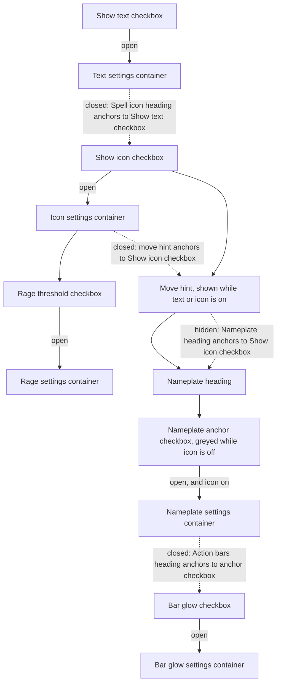

# Collapsible Options Sections - Plan

## Goal Capsule

- **Objective:** A player opening an ability's options tab sees only the settings for features they have turned on, so the page is short and easy to scan. Turning a feature on reveals its settings right away, and nothing they set before is lost.
- **Means:** Each collapsible section's settings live in their own hidden-or-shown group on the page, and the page re-flows below any group that changes (KTD1, KTD2). The rage threshold gets a real on/off setting (KTD4).
- **Authority:** The Product Contract's Requirements win on behavior. Key Technical Decisions win on mechanism within them. A unit overrides neither.
- **Stop conditions:** Stop and report if hiding a group leaves controls overlapping or unreachable in the emulator, or if the page height cannot be made to follow the visible controls (KTD3). Stop if the rage migration would turn any existing player's threshold on or off differently from R11.
- **Execution profile:** One change set, left uncommitted in the working tree. The user commits by hand; the agent does not commit, push, branch or open PRs. Units are ordered by dependency.
- **Who finishes:** The implementer lands U1 to U5 and verifies them in the emulator. The user does the in-game look-over in the Verification Contract and commits.

---

## Product Contract

### Summary

On each ability tab, the On-screen text, Spell icon, Nameplate and Action bar glow sections collapse to their on/off checkbox while that feature is off. Their settings appear as soon as it's turned on. The rage threshold gets its own checkbox instead of "0 = off", and its settings collapse the same way inside the Spell icon section. The page's scroll length follows what is shown.

### Problem Frame

Each ability tab has grown to about 1700 pixels of controls: sound, text, icon, glow, blue tint, rage threshold, nameplate, action bar glow and countdown. Most players leave several of those features off, but their settings still fill the page, so finding the one setting they want means scrolling past many that do nothing. The rage threshold adds to the confusion: it is "on" when its slider is above 0, which a player has to read the label to discover.

### Requirements

**Collapsing sections**

- R1. The On-screen text section's settings (custom text, text size, Unlock, Reset position, Preview) show only while "Show text" is ticked.
- R2. The Spell icon section's settings (icon size, Unlock, Reset position, Preview, glow, blue tint, rage threshold) show only while "Show the icon" is ticked.
- R3. The Nameplate section always shows its heading and the anchor checkbox. Its other settings (also show at normal position, the Overpower note, side, offsets, offset hint, fallback) show only while both the spell icon and the anchor are on. While the icon is off, the anchor checkbox stays greyed out with its tooltip.
- R4. The Action bar glow section's settings (glow style, Preview, hint) show only while its glow checkbox is ticked.
- R5. Ticking or unticking a section's checkbox shows or hides its settings at once. The sections below move up or down with no gap or overlap, and the page's scroll length fits what is shown.
- R6. Collapsing only changes what is shown. Hidden settings keep their values, and turning the feature back on shows them as they were.
- R7. A page shows the right sections when it opens and after a profile or talent-set switch.
- R8. The move hint ("Unlock, then drag…") shows while the text or the icon is shown.

**Rage threshold**

- R9. The rage threshold has its own checkbox, off by default. Its slider, look, colour and hint show only while it is ticked, and only while the Spell icon section is open.
- R10. While ticked, the threshold runs from 1 to 100 rage. A player turning it on for the first time starts at 30.
- R11. A saved or imported setting from before this change with a threshold above 0 loads ticked, keeping its number. One at 0 loads unticked, with the threshold set to 30 for when it is turned on.
- R12. Unticked, the icon looks normal whatever the number, as a threshold of 0 did before.
- R13. Whether the threshold is on is saved in the active profile and carried by profile export and import.

### Key Decisions

- **Ability tabs only.** The General tab keeps greying out its talent-set dropdowns and icon group settings. Governs R1 to R4.
- **The top "Enable alert" checkbox does not collapse the page.** It stays an ordinary setting so a disabled ability's settings can still be changed. Governs R1 to R4.
- **Sound and Countdown stay as they are.** Sound has no on/off checkbox, and Countdown has nothing under its checkbox. Governs R1 to R4.
- **The nameplate anchor stays visible while the icon is off.** The greyed checkbox and its tooltip tell the player why it does nothing. Governs R3.
- **Existing thresholds carry over by value.** Above 0 means the player had it on. Governs R11.
- **30 rage is the first-time starting value.** It is a mid-range guess at a useful threshold; the user accepted it in scoping. Governs R10.

### Scope Boundaries

- Sound, Countdown, the stance checkboxes, and the General tab are unchanged.
- No new collapse arrows or headings that toggle on click: a section opens through its existing feature checkbox only.
- Considered and not built: remembering a per-section "collapsed" state apart from the feature's own on/off setting. The request ties collapsing to the feature being off, so a separate state would add a setting nobody asked for.

---

## Planning Contract

### Key Technical Decisions

- KTD1. **One container frame per collapsible section.** Each section's settings are created with an invisible container frame as their parent instead of the page, so hiding the container hides every one of them. The container covers the page, takes no mouse input and has no layout of its own. The rage threshold's container sits inside the Spell icon's, so closing the icon section also hides the rage settings. Chosen over calling `SetShown` on each control, which is easy to get wrong when a control is added later. The control helpers in `Options.lua` (`CreateCheckbox`, `CreateRadioDropdown`, `CreateNumberSlider`, `CreateNumberBox`, `CreateButton`, `Label`) already take a parent, so only the parent passed in changes.
- KTD2. **The page re-flows by re-pointing one anchor per section.** Whatever follows a collapsible section anchors to the section's last control while it is open, and to its feature checkbox while it is closed. The move hint is a link in that chain: it follows the Spell icon section, and the Nameplate heading anchors to the hint while the hint is shown and to the "Show the icon" checkbox while it is hidden, so the two never share a slot and no gap is left. One page-level relayout function re-points these anchors and shows or hides each container. It runs when a section's checkbox is clicked and from the page's refresh function (`BuildAbilityPage`'s returned refresher, which `ns.RefreshOptions` and tab selection already call). This extends the existing `PlaceChannel` / `customBox.Place` pattern, which already moves the channel label when the custom-sound box hides.
- KTD3. **The page height follows the visible controls.** After each relayout, the page's content frame is resized to end just below the last visible control, replacing the fixed 1680-pixel height `ns.CreateOptions` gives each ability tab. Measure from visible controls only, since a hidden frame may report no position.
- KTD4. **The rage threshold gets a separate saved on/off value.** A new per-ability boolean sits beside `rageThreshold` in `Defaults()` in `OverpowerAlert.lua`, defaulting to off, and `rageThreshold` defaults to 30 with a range of 1 to 100. `NormalizeAbility` derives the boolean from the threshold when it is missing or not a boolean, before defaults are filled in, so saved profiles and imported strings both go through it (R11). A threshold below 1 becomes 30. `ns.RageLook` checks the boolean instead of `rageThreshold <= 0`. It is the only gate: `Display.lua` reaches the threshold only through `ns.RageLook`, so the blue-tint interplay follows automatically.
- KTD5. **The nameplate container opens only when the icon and the anchor are both on.** The relayout function owns this rule along with the anchor's greying (the existing `RefreshPlate`), so one function decides everything on the page.

### High-Level Technical Design

Which settings each checkbox controls, and what each closed section's follower anchors to:

Page order is unchanged: description, enable, stances, sound, On-screen text, Spell icon (glow, blue tint, rage threshold), move hint, Nameplate, Action bar glow, Countdown, slash hint.

### Risks

- **Layout measuring in game.** The emulator may lay out frames differently from the client, so a page height that fits in tests could clip or leave space in game. The in-game look-over in the Verification Contract checks it.
- **Importing into an older version.** An older version of the addon ignores the new on/off value, so a profile exported with the threshold off at 30 would show the threshold as on there. Players rarely share profiles backwards, so this is accepted.

---

## Implementation Units

### U1. Rage threshold on/off setting

- **Goal:** The rage threshold is on or off by its own saved value, with existing settings carried over.
- **Requirements:** R10, R11, R12, R13
- **Dependencies:** none
- **Files:** `OverpowerAlert.lua`, `tests/ragethreshold.test.wowlua`
- **Approach:**
  1. Add the boolean to `Defaults()` and change the `rageThreshold` default and comment (KTD4).
  2. In `NormalizeAbility`, derive the boolean before the defaults loop, then clamp the threshold to 1-100 with anything below 1 becoming 30.
  3. Gate `ns.RageLook` on the boolean.
  4. Update existing tests that turn the threshold on by setting a number, so they also tick it (the curve, icon, nameplate and "without the game's function" tests).
- **Patterns to follow:** the `anyStance` and `nameplateGap` migrations already in `NormalizeAbility`.
- **Test scenarios:**
  - Every ability starts unticked with a threshold of 30, tint, and the default blue.
  - Importing `{ rageThreshold = 40 }` without the new value loads ticked at 40.
  - Importing `{ rageThreshold = 0 }` loads unticked at 30.
  - Importing the new value as ticked with `rageThreshold = 0` loads ticked at 30.
  - Importing the new value as a non-boolean (a string) derives it from the threshold instead.
  - Thresholds clamp: 150 becomes 100, -5 becomes 30, 12.6 becomes 13.
  - Unticked with a threshold of 50: `ns.RageLook` returns nil and the game's function is never called.
  - Ticked at 30 with tint: the existing curve results hold.
  - Export and import keep the on/off value, threshold, look and colour.
- **Verification:** The rage threshold tests pass with the new defaults, and the icon tests still show the normal look when it is off.

### U2. Collapsing the text and icon sections

- **Goal:** The On-screen text and Spell icon sections collapse to their checkbox while off, and the page re-flows and resizes.
- **Requirements:** R1, R2, R5, R6, R7, R8
- **Dependencies:** none
- **Files:** `Options.lua`, `tests/optionslayout.test.wowlua` (new)
- **Approach:**
  1. Give `BuildDisplaySection` a container (KTD1) for everything below its show checkbox, including what `buildExtra` creates, and return it with the show checkbox.
  2. Create the glow dropdown, blue tint checkbox and the existing rage threshold controls in the icon container. U3 adds the rage checkbox and its own container.
  3. Add the page relayout function (KTD2, KTD3). Hook it to both show checkboxes' clicks and call it from the page refresher.
  4. Keep the move hint outside both containers and show it while either is open (R8), with the Nameplate heading following it as KTD2 describes.
- **Patterns to follow:** `PlaceChannel` / `customBox.Place` for re-pointing an anchor; the existing `RefreshPlate` hook on the show-icon checkbox.
- **Test scenarios:** Each finds controls by their label text under the Overpower tab, as `tests/nameplateoption.test.wowlua` does. That catches what a player sees and clicks. It misses pixel-level overlap, which the in-game check covers.
  - With text on, the custom text box, text size dropdown and Unlock Text button are visible. Unticking "Show text" hides all three.
  - With text unticked, the Spell icon heading sits directly under the "Show text" checkbox: its top is higher than when text was on.
  - Unticking the icon hides the icon size slider, glow dropdown, blue tint checkbox and the rage threshold slider, and the Nameplate heading moves up.
  - Re-ticking restores visibility, and an icon size of 100 and custom text "GO" set before unticking are still saved and shown.
  - The page's content height drops when sections collapse and grows back when they open, and the slash hint stays inside it.
  - Switching to a profile with text off, then refreshing the options, shows the text section closed.
  - With text off and icon on, the move hint is visible. With both off, it is hidden.
  - With text on and icon off, the move hint sits below the "Show the icon" checkbox and the Nameplate heading sits below the hint. With both off, the Nameplate heading sits directly below the checkbox.
- **Verification:** The new tests pass, and the existing options test (`tests/nameplateoption.test.wowlua`) still passes.

### U3. Rage threshold checkbox and its section

- **Goal:** The rage threshold is turned on with a checkbox, and its settings collapse under it.
- **Requirements:** R9, R10
- **Dependencies:** U1, U2
- **Files:** `Options.lua`, `Strings.lua`, `tests/optionslayout.test.wowlua`
- **Approach:**
  1. Add the checkbox in the icon container, bound to the U1 setting, with a nested container for the slider, look dropdown, colour swatch and hint.
  2. Change the slider's range to 1-100.
  3. Replace the "Rage threshold (0 = off)" label with a checkbox label and a slider label that no longer mention 0.
  4. Include the rage container in the relayout function.
- **Test scenarios:**
  - By default the rage checkbox is unticked, and the slider, look dropdown, colour swatch and hint are hidden.
  - Ticking it saves it as on, shows those controls, and the slider shows 30.
  - With the threshold ticked, unticking the icon hides the rage checkbox and its controls. Re-ticking the icon brings them back still ticked.
  - With the threshold ticked, the colour swatch still shows only while the look is Tint.
  - The slider's lowest value is 1.
- **Verification:** The rage controls behave as above, and the tests in U2 still pass.

### U4. Collapsing the nameplate and action bar glow sections

- **Goal:** The Nameplate and Action bar glow sections collapse to their checkbox while off.
- **Requirements:** R3, R4, R5
- **Dependencies:** U2
- **Files:** `Options.lua`, `tests/optionslayout.test.wowlua`, `tests/nameplateoption.test.wowlua`
- **Approach:**
  1. Put the nameplate settings below the anchor checkbox in a container that opens per KTD5. Fold `RefreshPlate`'s greying into the relayout function.
  2. Put the glow style dropdown, Preview and hint in a container under the bar glow checkbox.
  3. Re-point the Action bars heading and the Countdown heading (or the slash hint for Execute) per KTD2.
- **Test scenarios:**
  - With the icon on and the anchor ticked, the side dropdown, offset boxes and fallback checkbox are visible. Unticking the anchor hides them and moves the Action bars heading up.
  - With the anchor ticked, unticking the icon hides the nameplate settings and greys out the anchor. Re-ticking the icon brings them back.
  - The Overpower note shows on the Overpower tab only while its nameplate settings are open.
  - Unticking the bar glow hides its style dropdown, Preview and hint, and moves the Countdown heading up.
  - On the Execute tab, which has no Countdown, unticking the bar glow moves the slash hint up.
  - The existing tests in `tests/nameplateoption.test.wowlua` still pass.
- **Verification:** The new and existing options tests pass.

### U5. README

- **Goal:** The README describes the rage threshold checkbox and the collapsing sections.
- **Requirements:** R9, R10, R11
- **Dependencies:** U1, U3
- **Files:** `README.md`
- **Approach:** Rewrite the "Rage threshold (0, off, by default)" bullet for the checkbox, the 1-100 range and the 30 starting value. Add one line where the options are described saying a section's settings appear when its feature is turned on.
- **Test expectation:** none -- documentation only.
- **Verification:** The README no longer mentions "0 = off" for the threshold.

---

## Verification Contract

| Check | How | Proves |
|---|---|---|
| Tests | `wowlua test` (or the wowlua MCP `test` tool) | U1 to U4 behavior. Every existing test still passes. |
| Static check | `wowlua check` | No new warnings beyond the libraries' existing `LibStub` ones. |
| In game | Open each ability tab and toggle each section's checkbox. Check that nothing overlaps, that the scroll bar ends just below the last control, and that settings come back as they were. Load a profile from before this change with a threshold set and check that its checkbox is ticked. | KTD3 layout in the real client, and R11 on real saved data. |

## Definition of Done

- U1 to U5 are done, and each unit's verification holds.
- All tests pass and `wowlua check` shows only the libraries' existing warnings.
- No leftover code from abandoned approaches is in the diff.
- Changes are left uncommitted for the user, with the new test file noted for them to include.
- The user has done the in-game look-over, or it is listed for them as outstanding.

## Open Questions

### Deferred to Implementation

- How to measure the last visible control's bottom reliably in both the emulator and the client (KTD3). If measuring right after a relayout returns nothing, measure on the next frame or when the page shows.
- Whether test helpers to find controls by label should move to a shared file or stay copied into each test file. wowlua test files may not share modules easily.
